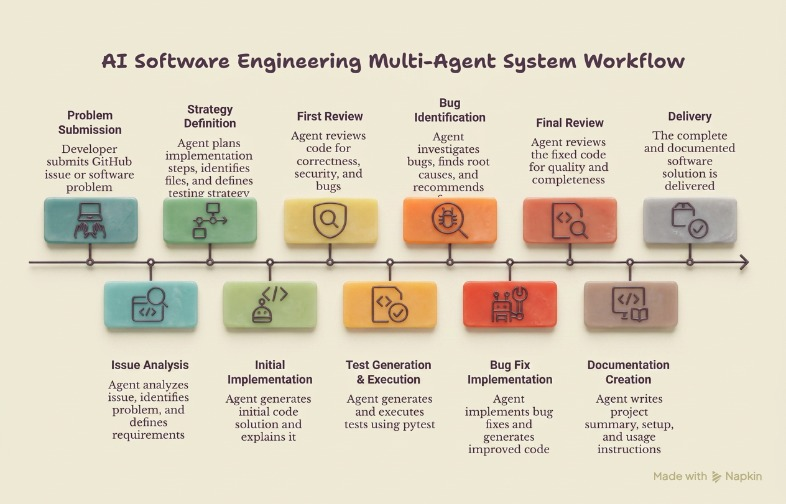
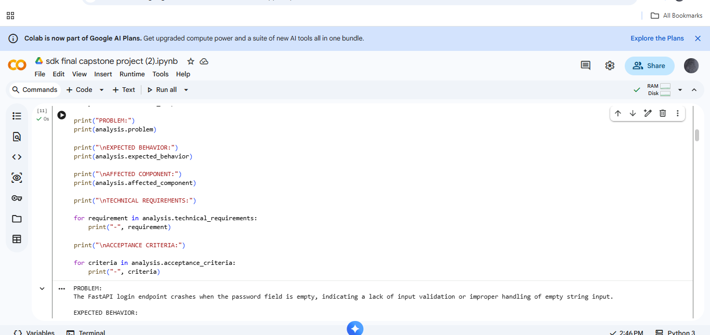
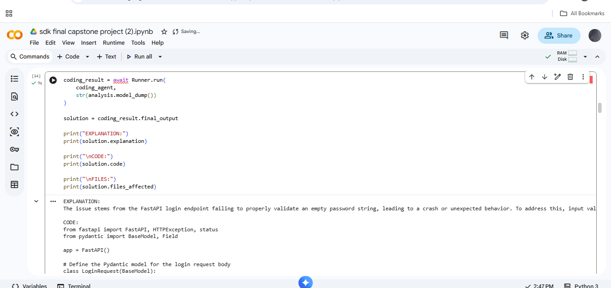
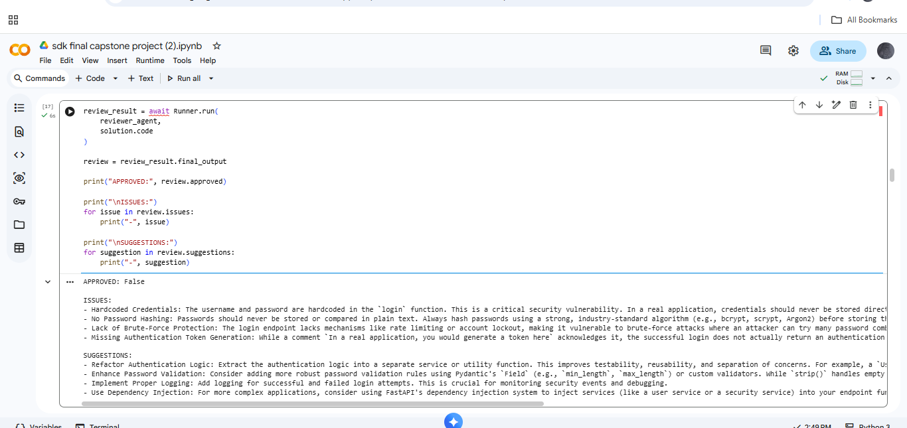
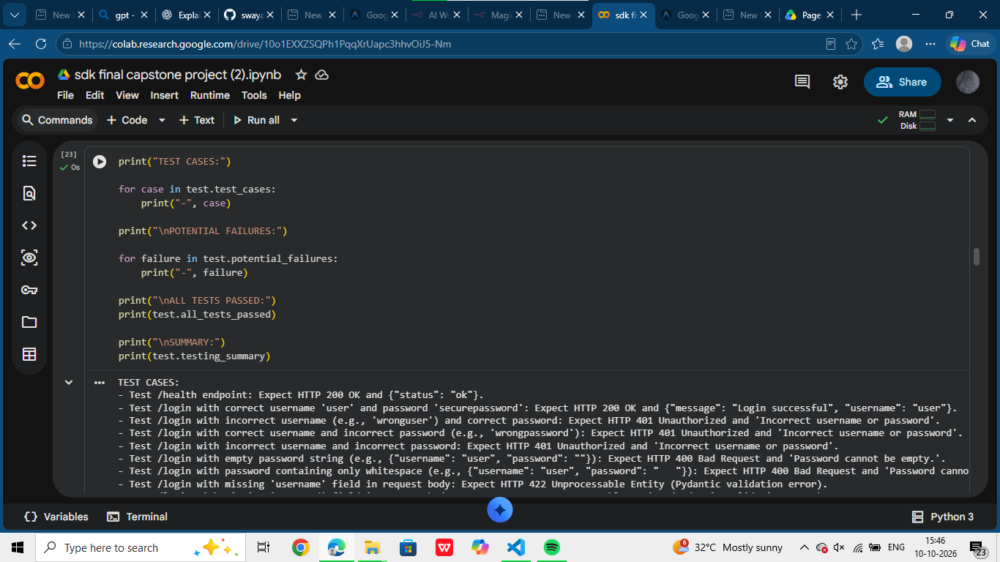
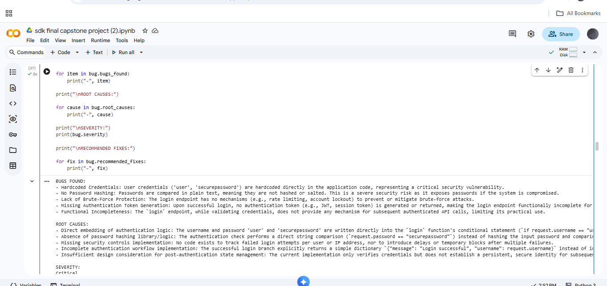
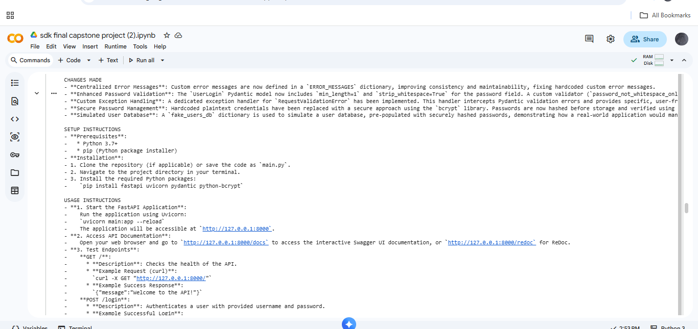

# AI Software Engineering Assistant

A multi-agent software-engineering prototype built in Google Colab using the **OpenAI Agents SDK**, **LiteLLM**, and **Gemini 2.5 Flash**. It demonstrates how specialized AI agents can support requirements analysis, code generation, code review, testing support, debugging, and documentation.

> **Project status:** Capstone prototype. Individual agent workflows are demonstrated, but this is not presented as a fully autonomous, production-ready end-to-end system.

## Highlights

- **Requirements analysis** — converts a software problem into structured requirements and acceptance criteria.
- **Code generation** — proposes an implementation from the analyzed requirements.
- **Code review** — reviews potential bugs, security concerns, readability, maintainability, and edge cases.
- **Testing support** — generates test cases and potential-failure analysis.
- **Test execution support** — the notebook includes a `pytest` tool; verify results in your own run before relying on them.
- **Bug investigation** — analyzes reported bugs, root causes, and recommended fixes.
- **Documentation generation** — creates setup, usage, and project documentation.
- **Code-file and GitHub issue analysis** — demonstrates supporting tools for inspecting source files and public issues.
- **Structured outputs** — uses Pydantic models for consistent, inspectable agent responses.

## Tech Stack

- Python and Google Colab / Jupyter Notebook
- OpenAI Agents SDK
- LiteLLM
- Gemini 2.5 Flash
- Pydantic
- pytest
- GitHub REST API

## Architecture

The prototype separates software-engineering responsibilities into specialized agents. The diagram summarizes the intended design; it does not imply that every step runs as one fully automated pipeline.



## Screenshots

The following screenshots were selected from the screenshots you provided and arranged in a logical order for the README. They show notebook code and/or outputs from the demonstrated workflow.

### 1. Requirements Analysis



*Extracts the problem, expected behavior, technical requirements, and acceptance criteria.*

### 2. Code Generation



*The Coding Assistant uses the analyzed requirements to propose an implementation.*

### 3. Code Review



*The reviewer agent inspects the generated code and reports review findings.*

### 4. Testing Agent Output



*The testing workflow defines test cases and discusses potential failures. This screenshot is not presented as proof that all tests passed.*

### 5. Debugging and Recommended Fixes



*The debugging agent identifies potential bugs, root causes, and recommended fixes.*

### 6. Generated Documentation



*The documentation workflow produces setup and endpoint-testing guidance.*

## Run the Notebook

1. Open [Google Colab](https://colab.research.google.com/).
2. Upload `sdk_final_capstone_project.ipynb`.
3. Add your Gemini API key through Colab Secrets using the secret name expected by the notebook.
4. Install any dependencies required by the notebook.
5. Run the cells in order and review each agent's output.

Model availability, API quotas, and package versions can affect execution.

## Security and Responsible Use

- Never commit API keys, access tokens, or other secrets.
- Use environment variables or Colab Secrets for credentials.
- Review AI-generated code before using it in a real application.
- Run generated code and tests only in an environment you control.
- Model responses may be incorrect; human review and deterministic testing remain important.

## Current Limitations

- This is a prototype demonstrated through notebook workflows, not a production deployment.
- A handoff execution encountered a Gemini quota error during the documented run.
- A complete persistent multi-turn workflow is not demonstrated.
- A fully automated, end-to-end code modification lifecycle is not demonstrated.
- Reliable orchestration, retries/provider fallback, production security, and CI/CD integration remain future improvements.

## Future Improvements

- Connect individual agents into a reliable orchestrated workflow.
- Complete and validate handoffs between specialist agents.
- Add persistent project context and safer sandboxed file modification.
- Add retries and provider fallback for quota or availability errors.
- Expand testing, static analysis, and repository-wide code search.
- Add CI/CD integration and automated pull-request review.

## Repository Structure

```text
ai-software-engineering-assistant/
├── README.md
├── sdk_final_capstone_project.ipynb
├── assets/
│   └── multiagent_workflow.jpeg
├── screenshots/
│   ├── 01-requirements-analysis.png
│   ├── 02-code-generation.png
│   ├── 03-code-review.png
│   ├── 04-testing-agent-output.png
│   ├── 05-debugging-findings.png
│   └── 06-documentation-output.png
└── docs/
    └── AI_Software_Engineering_Assistant_Technical_Documentation.pdf
```

## Author

**Swayam Sachdeva**
